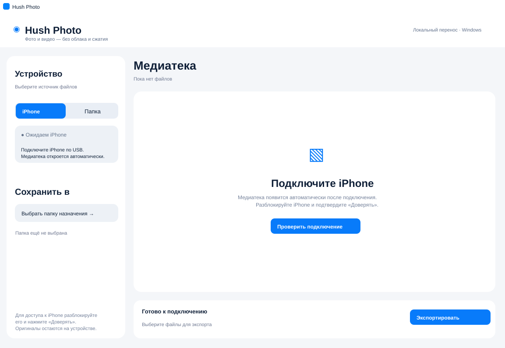
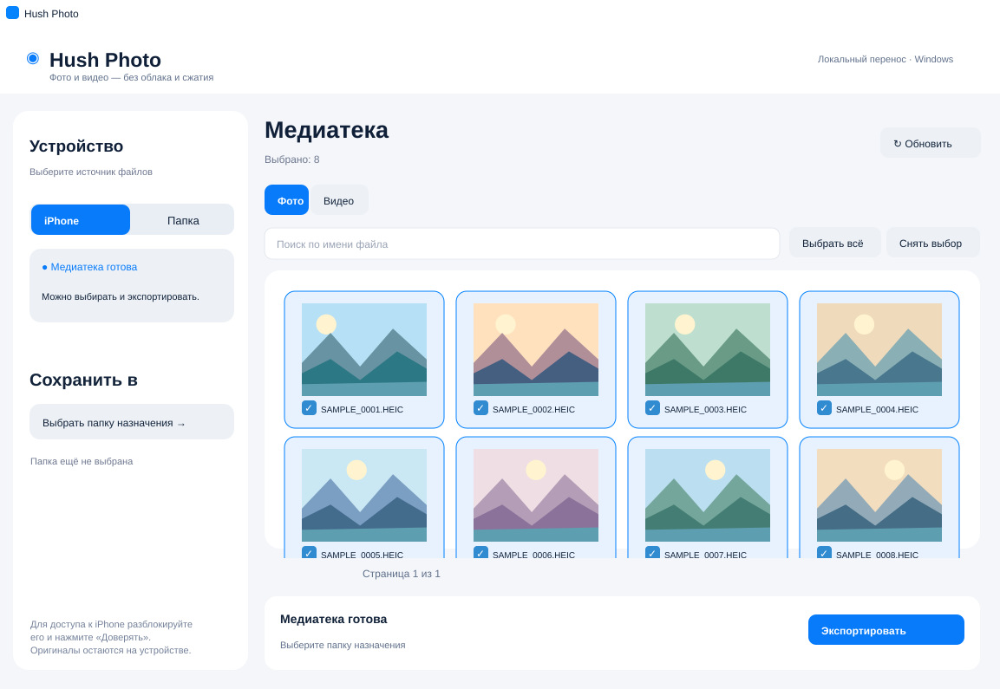
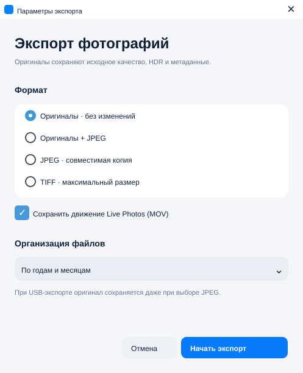

# Hush Photo — примеры интерфейса

[Русский](../README.md) · [English](../README_EN.md) · [简体中文](../README_ZH.md)

Эта страница показывает три основных состояния интерфейса **Hush Photo для Windows**: ожидание подключения iPhone, просмотр медиатеки и выбор параметров экспорта.

> **О конфиденциальности и достоверности:** изображения ниже — иллюстративные примеры, созданные на основе реальных экранов приложения. Для демонстрации медиатеки используются вымышленные имена файлов и нейтральные пейзажи вместо личных фотографий. Некоторые данные (например, количество файлов) являются демонстрационными. Изображения не являются результатами отдельного теста устройства или измерения скорости экспорта.

## 1. Подключение устройства

Hush Photo автоматически проверяет подключение iPhone в фоновом режиме, когда доступны инструменты обнаружения устройства. Для доступа к медиатеке разблокируйте iPhone и подтвердите доверие компьютеру. Кнопка **«Проверить подключение»** позволяет начать проверку вручную.

## 2. Просмотр и выбор файлов

После сканирования можно просматривать фотографии и видео, искать файлы по имени и отмечать нужные элементы. Миниатюры фотографий загружаются по мере просмотра; медиатека отображается страницами. Для видео доступны категории **«Все видео»**, **«Видеоролики»** и **«Live Photos»**. Экспорт учитывает только выбранные файлы текущего фильтра, не сбрасывая выбор других категорий.

## 3. Параметры экспорта

<figure>

</figure>

В диалоге экспорта фотографий доступны оригиналы, оригиналы с JPEG, JPEG и TIFF. Можно сохранить MOV-компонент Live Photo, выбрать качество JPEG и способ организации каталогов: по месяцу съёмки, исходная структура или одна папка.

**Важно:** при экспорте фотографий с iPhone через USB исходные файлы сохраняются даже при выборе создания JPEG или TIFF. Видео MOV/MP4 копируются без перекодирования. Для надёжного сохранения HDR и исходных метаданных рекомендуется экспорт оригиналов.

## Дополнительные материалы

Полные требования, конфигурация AFC/libimobiledevice, ограничения iCloud, работа с дубликатами, тестирование и сборка portable описаны в основных инструкциях: [RU](../README.md), [EN](../README_EN.md), [ZH](../README_ZH.md).
